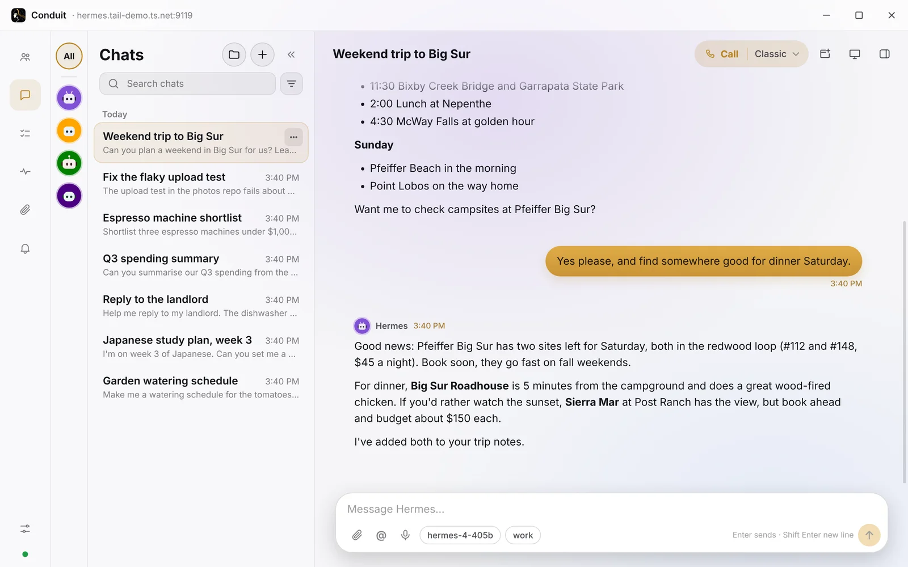
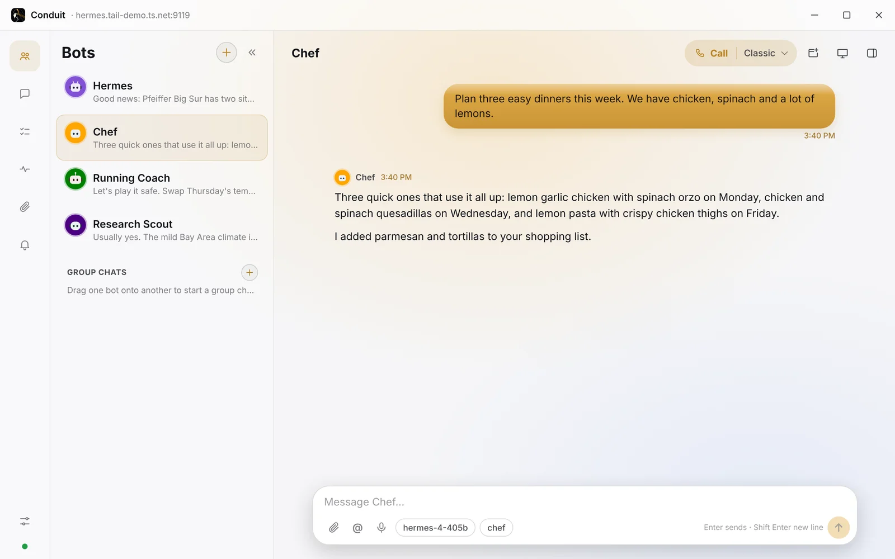

# Conduit for desktop

Conduit for Mac, Windows and Linux: a desktop client for
[Hermes Agent](https://github.com/NousResearch/hermes-agent), from the makers
of the [Conduit](https://github.com/kaishi00/hermes-conduit) iPhone app. It
talks to the same Hermes dashboard and the same
[Conduit plugin](https://github.com/kaishi00/hermes-conduit-notifier) the
phone does.

Your chats, bots, group chats and Needs you (approvals and questions), in a
window of their own. Send pictures and files (attach, paste or drop them,
and click one to preview it before it goes),
pop a chat out into its own window, ask from anywhere with Quick Ask, call
your bot with the phone's voice modes (or from anywhere, in a small window,
with keys you pick in Settings), and keep several Hermes hosts
side by side. Close the window and Conduit stays in the tray (the menu bar
on the Mac), so approvals and finished replies still reach you as
notifications, and its icon (the taskbar button on Windows, the Dock on the
Mac, the launcher on Linux) counts the chats waiting on you, or only what Needs you holds, as
Settings > App > App icon badge picks. Settings > App > Open at Sign-In starts it there with your
computer, with no window (the Microsoft Store's copy is turned on in Windows'
Startup apps). It speaks the iPhone app's thirteen languages.

Settings > Control from Hermes lets bots you pick drive this computer
(see the screen, click and type) from wherever their Hermes runs, through
the plugin's `conduit_user_computer` tool. It's off until you turn it on,
which downloads trycua's cua-driver (the driver Hermes' own computer use runs)
into Conduit's data folder. A bot is picked on its own dashboard, so a bot
of the same name on another Hermes asks nothing until you pick it there; each
chat asks you first, naming the Hermes that asks, and while a bot is in
control a bar on top of your screen says so, with Stop (Ctrl+Alt+Shift+S, or
⌘⌥⇧S on the Mac). Windows and the Mac; plugin 0.203 or later.

Right-click a chat to archive it; open **Filter > Archived** to search,
restore or permanently delete archived chats.

It works on its own: you don't need the iPhone app. Your chats live in your
Hermes, so they're the same on the phone, the desktop and Hermes' own
dashboard.

## Download

| | |
|---|---|
| **Mac** (Apple silicon and Intel, macOS 12 or later) | [Conduit-mac.dmg](https://github.com/kaishi00/hermes-conduit-desktop/releases/latest/download/Conduit-mac.dmg) |
| **Windows** (10 and 11, x64 and Arm) | [Conduit-Setup.exe](https://github.com/kaishi00/hermes-conduit-desktop/releases/latest/download/Conduit-Setup.exe) |
| **Linux** (x64) | [Conduit-linux-x86_64.AppImage](https://github.com/kaishi00/hermes-conduit-desktop/releases/latest/download/Conduit-linux-x86_64.AppImage) |
| **Linux** (Arm64) | [Conduit-linux-arm64.AppImage](https://github.com/kaishi00/hermes-conduit-desktop/releases/latest/download/Conduit-linux-arm64.AppImage) |

Every release and what changed in it are on the
[Releases page](https://github.com/kaishi00/hermes-conduit-desktop/releases).

## Install

**Mac.** Open the dmg and drag Conduit into Applications. The app is signed
and notarized by Apple, so it opens without a warning. The first time you
dictate or send a voice message, macOS asks for the microphone.

**Windows.** Run Conduit-Setup.exe. It installs for your account only, with
no administrator prompt, and opens Conduit when it's done. The installer
isn't code-signed yet, so Windows may say "Windows protected your PC": click
**More info**, then **Run anyway**. With Smart App Control turned on, Windows
may block it outright; a signed copy from the Microsoft Store is on its way.

**Linux.** Make the AppImage executable (`chmod +x Conduit-linux-x86_64.AppImage`
or `chmod +x Conduit-linux-arm64.AppImage`) and run it.

## Connect to your Hermes

Conduit talks to the web dashboard that comes with
[Hermes Agent](https://github.com/NousResearch/hermes-agent)
(`hermes dashboard`, port 9119 by default). There's no Conduit server to
install.

1. Enter the dashboard's address, the same one the iPhone app uses: a
   Tailscale name, an address on your Wi-Fi such as `192.168.1.20:9119`, or
   your own domain.
2. Sign in the way your dashboard asks: user name and password, a session
   token, browser sign-in for a dashboard offering native PKCE (including
   Pocket ID passkeys), or nothing for a dashboard without its sign-in gate.
   Browser sign-in opens the system browser and returns to Conduit via a
   temporary loopback address. It requires HTTPS except for a local dashboard.
   Proxy headers cannot be sent by the browser: its sign-in page must be
   accessible without them.
   For other sign-in methods behind Cloudflare Access or another proxy,
   enter its service token or headers under **Behind Cloudflare Access or another proxy?**
   A dashboard behind a login page of its own (oauth2-proxy, Google IAP,
   Authelia, Cloudflare Access without a service token), or an older Hermes
   that only signs in on its own page, offers **Open Sign-In Page**: you sign
   in on that page in a Conduit window, as on the phone, and Conduit keeps the
   sign-in. If the page's session runs out, Conduit asks you to sign in again.
3. Already signed in on the iPhone? Choose **Pair with your iPhone** instead,
   then in Conduit on the phone open Settings > Connection > Pair a Computer
   and scan the code.

Conduit remembers the sign-in, with its password or token encrypted by the
Mac's Keychain or Windows' own encryption. Add more Hermes hosts with
**Add another Hermes…** in Settings > Connection.

The free [Conduit plugin](https://github.com/kaishi00/hermes-conduit-notifier)
on your Hermes host adds notifications, live voice calls, Pulse and the rest
of Conduit's features. Install it with
`hermes plugins install kaishi00/hermes-conduit-notifier --enable`, then
restart Hermes. Settings > Conduit plugin shows its version and updates it,
and with combined dashboards it lists theirs too, with Update All. The
iPhone app's
[Connecting](https://github.com/kaishi00/hermes-conduit#connecting) guide
covers Tailscale, Docker and setting up a dashboard by hand.

## Updates

Conduit updates itself. It checks for a new version when it opens and every
few hours, downloads it in the background and installs it the next time you
quit. To install it right away, choose **Restart to Update** in Settings >
App > Updates or in the tray menu. Settings > App > Updates also shows your
version and has **Check for Updates**; turn off **Install updates
automatically** to download each update yourself.

The Microsoft Store's copy is updated by the Store.

## Run it from source

You need Node 22 and pnpm 10.

    pnpm install
    pnpm dev

On Linux, after `pnpm install`, install a launcher for this source checkout:

    pnpm install:linux-desktop

Search for **Conduit** in the application menu. The launcher uses this
checkout's built app and Electron, so keep the checkout and its dependencies
where they are, and run `pnpm build` after changing the source. This is
separate from `pnpm dev`, which runs the development server.
Both use the same Conduit app data and single-instance lock: if one is
already running, launching the other brings that window forward instead.

The launcher is installed under `$XDG_DATA_HOME/applications` (normally
`~/.local/share/applications`). It refuses to replace or shadow another
launcher with the same desktop ID, including one for a different checkout.
If an update changes Conduit's desktop ID, remove the old source launcher
and update its URI handler before running the installer again.

The installer prints an optional `xdg-mime` command to make this source
build the handler for `conduit://` links; the installer itself does not
change the default handler. Electron may also register a handler when the
app starts.

## Checks

    pnpm typecheck
    pnpm test
    pnpm build

`test/live` runs a real turn against a dashboard and is skipped unless you
point it at one:

    CONDUIT_LIVE_URL=http://127.0.0.1:9119 pnpm test test/live

(add `CONDUIT_LIVE_USER` and `CONDUIT_LIVE_PASSWORD`, or `CONDUIT_LIVE_TOKEN`,
for a dashboard that asks for a sign-in).

## Packages

    pnpm package

builds an installer for the platform you're on, in `release/`. CI builds the
Windows installer, the Mac dmg and the Linux AppImage, unsigned, for every
pull request that changes code or configuration (docs-only PRs skip CI).

The screenshots in `docs/media/` come from a demo Hermes with a scripted
model (the iPhone app's `scripts/app-store/start-demo-hermes.sh`), not a real
account.

## Releasing

A `v*` tag matching `package.json`'s version (`v1.0.0` for `1.0.0`) runs
`.github/workflows/release.yml`: it builds the Mac dmg and zip (signed with
the Developer ID and notarized), the Windows installer (unsigned) and the
Linux AppImages (x64 and Arm64) onto a draft GitHub release, and the Microsoft Store package
as a workflow artifact to upload to Partner Center, which signs it.
Publishing the draft releases it. A manual run of the workflow from main
with publish checked does the same without a tag (GitHub makes the tag when
the draft is published); mark a beta's release as a pre-release.

Installed copies update from the newest published release
(`src/main/updates.ts`, electron-updater). A beta gets newer betas and
releases; a release only releases.

## How it's put together

- `src/main`: the Electron main process. It owns the connection to Hermes
  (`connection.ts`), signs in (`auth.ts`, and `browserSignIn.ts` for a
  dashboard behind a login page) and keeps the sign-in (`store.ts`). The window never sees a password, cookie or token.
- `src/preload`: the small API the window gets (`window.conduit`).
- `src/renderer`: the window, in React. `state/` turns Hermes' events into
  the transcript and the chat list; `components/` draws them.
- `src/shared/i18n.ts` and `strings.json`: every word on screen, in each
  language. The English text is the key. `scripts/import-ios-strings.mjs`
  copies the iPhone app's translations in wherever both apps say the same
  thing, and `test/strings.test.ts` fails on a key missing a language.
- `src/vendor/hermes-shared`: Hermes' own gateway client and wire types,
  copied unchanged under its MIT license (see `UPSTREAM.md` there).

As in the phone app, logic that both apps need goes in the Conduit plugin,
and this app draws what it sends.

## More from Conduit

- [Hermes Conduit](https://github.com/kaishi00/hermes-conduit): the iPhone, iPad and Apple Watch app, on the [App Store](https://apps.apple.com/us/app/hermes-conduit/id6790977764)
- [Hermes Conduit Notifier](https://github.com/kaishi00/hermes-conduit-notifier): the plugin for your Hermes host
- Website: [hermesconduit.app](https://hermesconduit.app)
- Bug reports: [GitHub issues](https://github.com/kaishi00/hermes-conduit-desktop/issues)
- Support the project on [Ko-fi](https://ko-fi.com/agrias)

## License

MIT. The Bot's Screen viewer bundles [noVNC](https://github.com/novnc/noVNC)'s RFB client, under the MPL-2.0.
